# Fulgor

**Vibrant shaders for Minecraft Java 26.3 on Apple Silicon, rendered natively with Metal.**

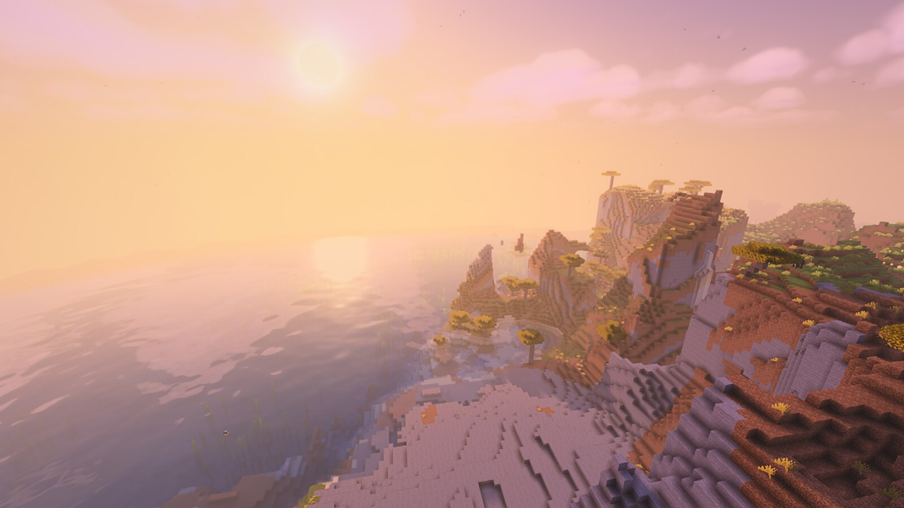

Fulgor is a Fabric mod that gives Minecraft the warm, saturated look of the classic "vibrant" shader packs — tilted
sun, soft volumetric clouds, turquoise water, long shadows, bloom — without OpenGL, Iris or a shader pack. It is a fork
of [Ciderlight](https://github.com/riccqi/ciderlight) by Richard Qi, which adds a native Metal rendering backend to
the game; Fulgor builds an HDR pipeline and a new look on top of it.

The visual reference is [Sildur's Vibrant Shaders](https://sildurs-shaders.github.io/). Fulgor is not a port: no code
from Sildur's is used, every shader is original Metal Shading Language, and the two projects are not affiliated.

> **Status: alpha.** It runs and looks as shown here, but there are no prebuilt releases yet and several settings
> are still JVM flags. Expect rough edges.

## Side by side

Same world, seed, position and time of day; left is the reference running on Iris + Sodium, right is Fulgor.

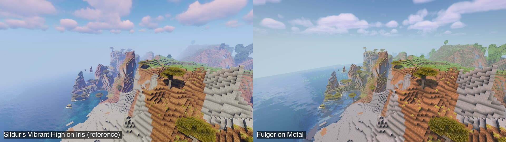

## Gallery

| | |
|---|---|
| 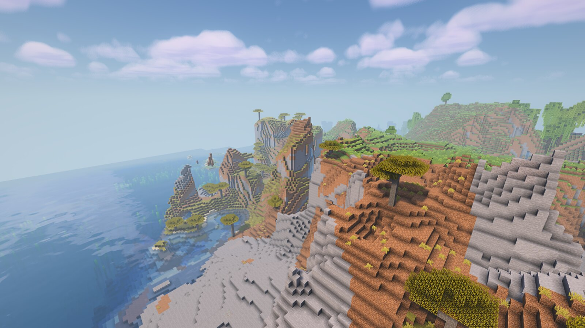 | 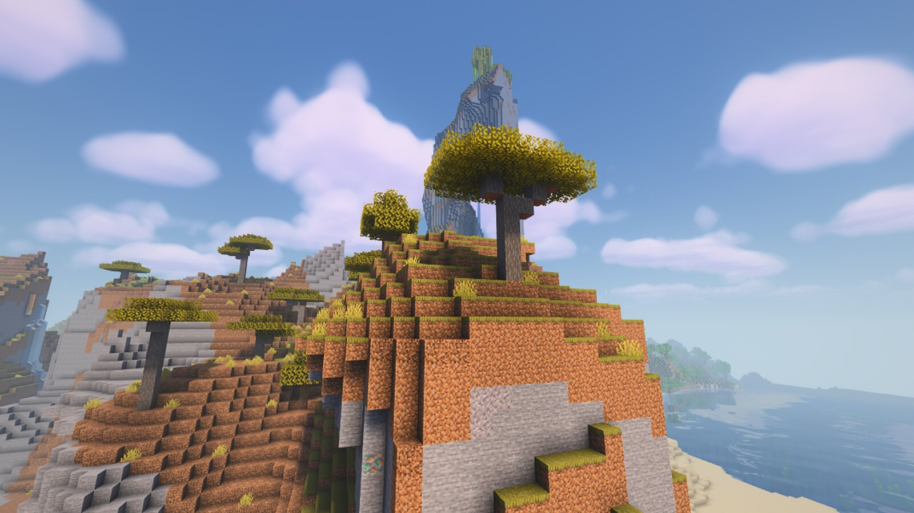 |
| 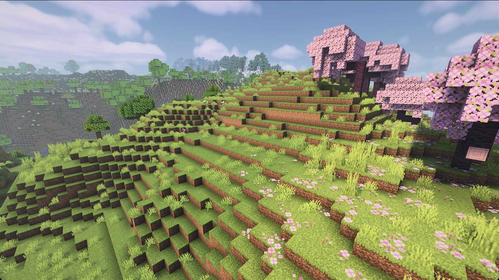 | 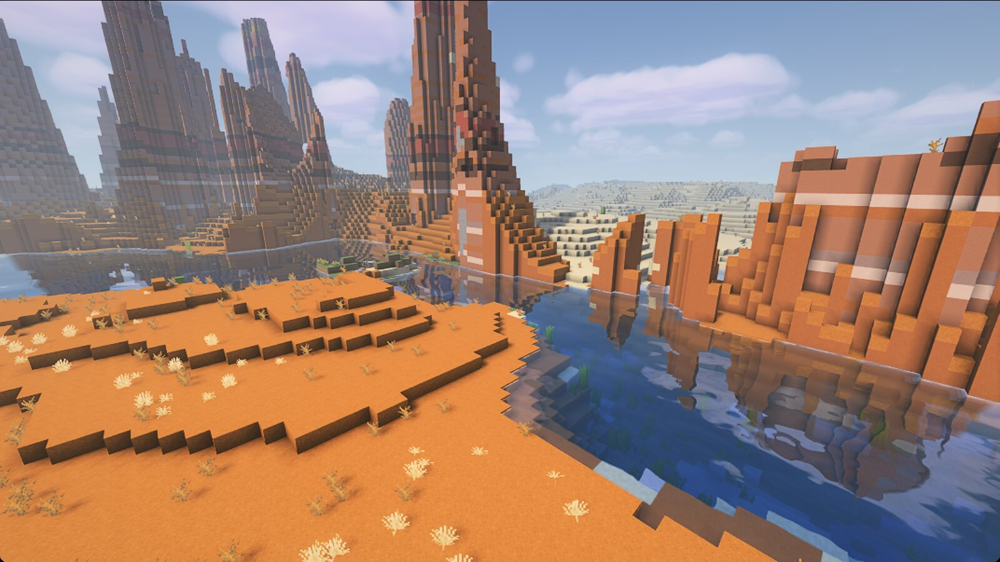 |
| 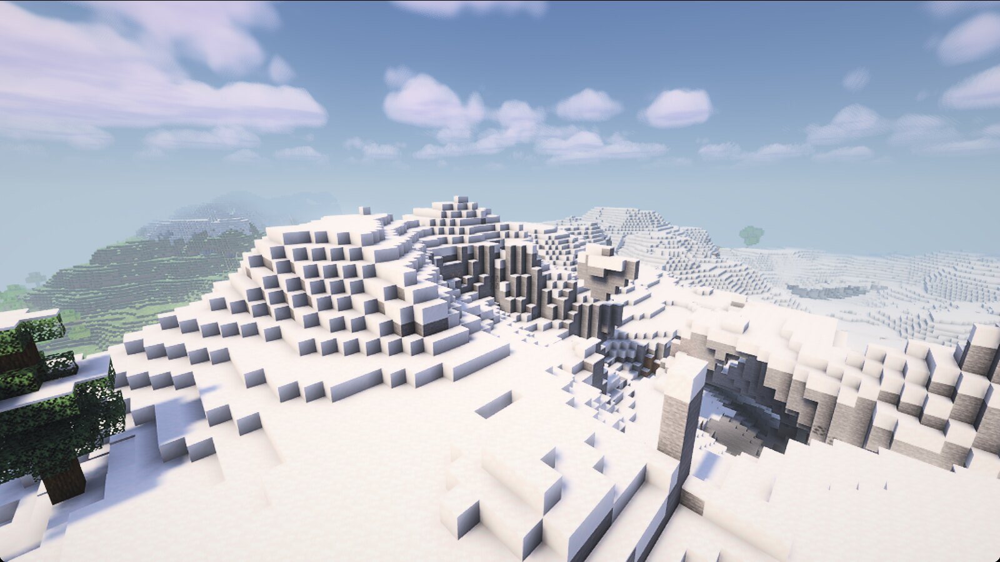 | 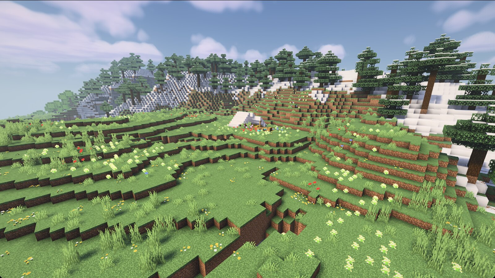 |
| 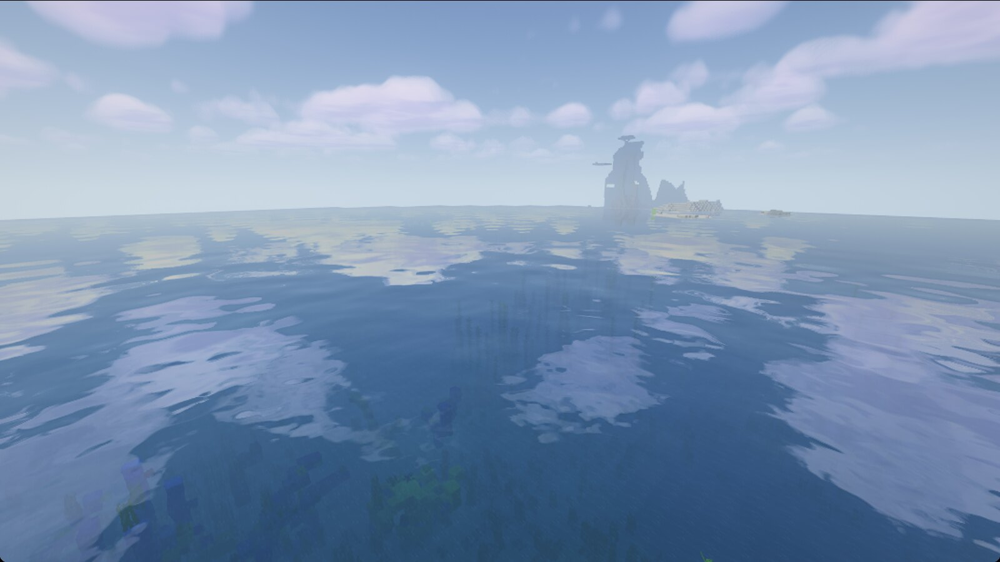 | 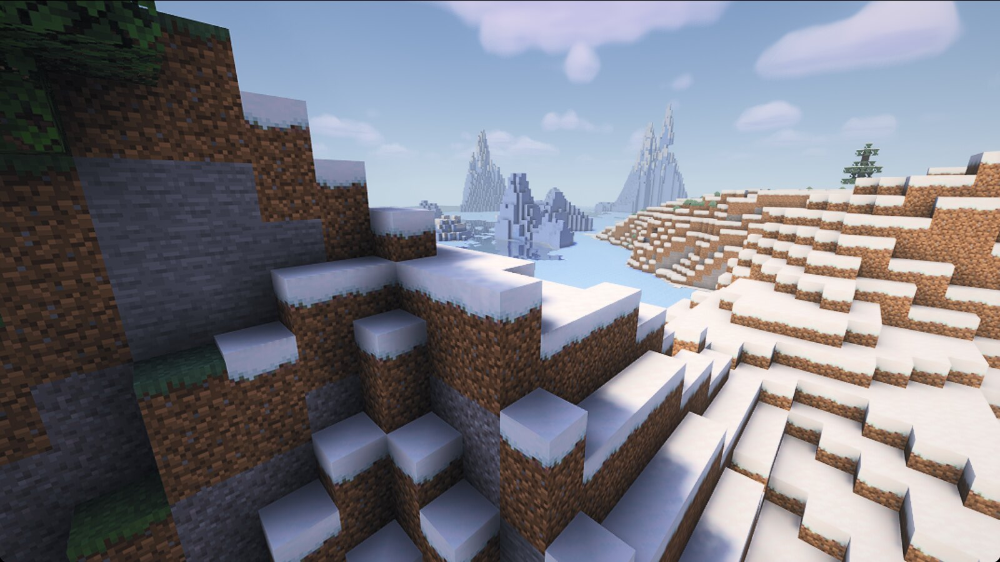 |
| 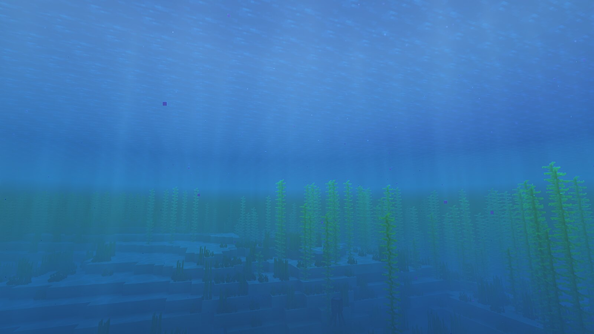 | 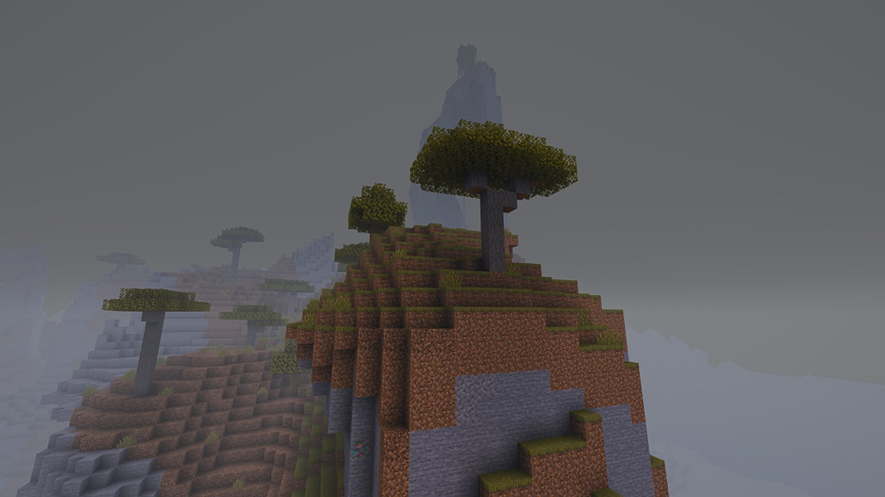 |
| 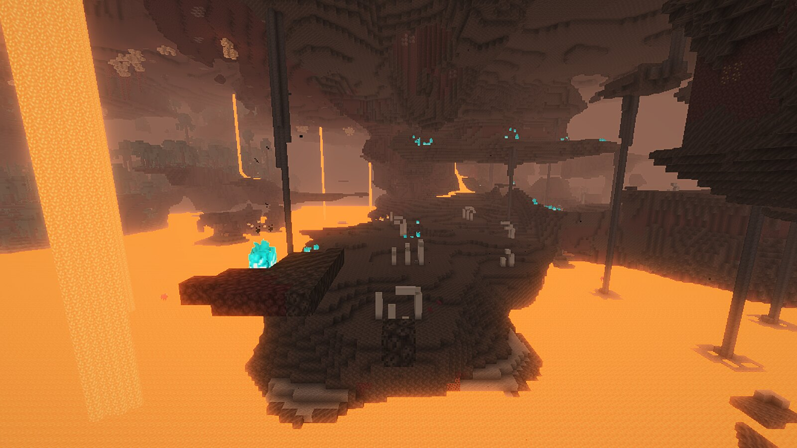 | 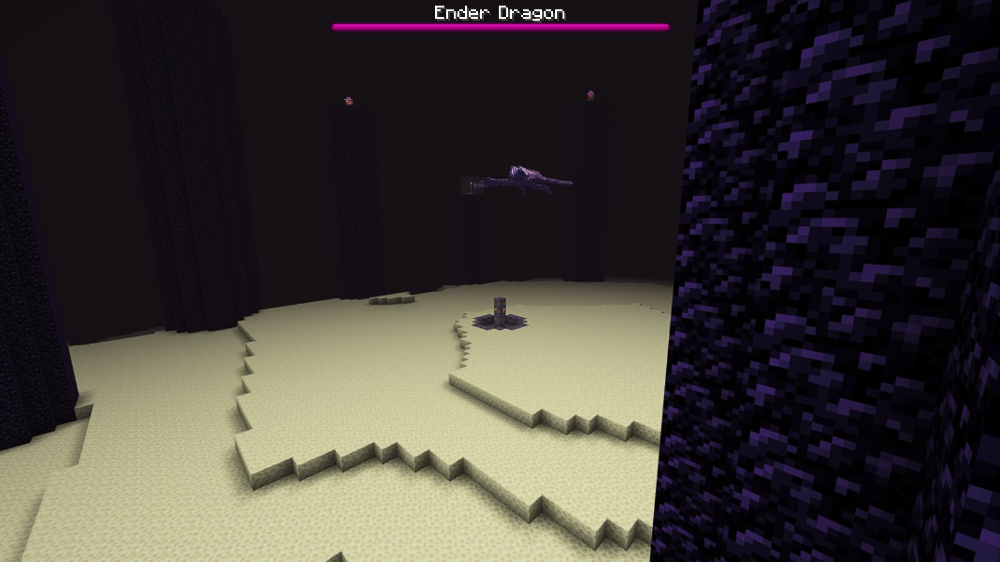 |

All screenshots are unedited captures at the default quality for a base M4 (Low).

## Performance

MacBook with a base M4 and 16 GB, 1600x900 window, render distance 16, the noon scene above. Both sides are read
from the game's own F3 fps counter every 5 seconds after a one-minute warm-up; the number is the median.

| Configuration | Median fps | vs. reference |
|---|---:|---:|
| Sildur's Vibrant High on Iris + Sodium (reference) | 43 | 1.0x |
| Fulgor, default on this Mac (Low: 2048 shadows, world at 67% scale) | 70 | 1.6x |
| Fulgor, matched settings (2048 shadows, full resolution) | 59 | 1.4x |
| Fulgor High (4096 shadows, far shadow cascade, volumetric light) | 49 | 1.1x |

The matched comparison was repeated in alternating rounds: the reference gave medians of 43, 40 and 42 fps, Fulgor
59, 58, 53 and 58. Fulgor's High does more work than the reference's High (which uses a single 2048 shadow map and
no volumetrics), so the matched row is the fair one. The other two Fulgor rows were measured once. This is one
machine and one scene; your numbers will differ.

## How close is the look?

Close enough to measure. `tools/biome-tour.sh` teleports through 20 biomes in both games and photographs each one,
and `tools/compare-stats.py` splits every pair of screenshots into sky, horizon and ground bands and fails if any
colour channel's mean differs by more than 24/255. Three consecutive full runs passed 60 of 60 biome bands and 27 of
27 bands across nine fixed scenes (noon, sunset, night, rain, underwater, torchlight, Nether, End and a ground-level
view), with the worst band at 21–23.

That is a statement about overall colour and brightness, not a pixel match. Known differences: soul fire stays cyan
as in vanilla, the sky is not visible through the water surface from below, and cloud shapes are our own.

## What it does

- **HDR pipeline**: the world is drawn into an HDR target, with bloom and a hue-preserving tone map.
- **Sun and sky**: sun path tilted 40 degrees so side faces catch light at noon, deep blue sky, yellow-to-pink sunsets,
  dark blue-grey nights.
- **Clouds**: soft volumetric cumulus lit by the sun.
- **Shadows**: real-time sun and moon shadows with a far cascade, including foliage and coloured light through
  stained glass, ice and water.
- **Water**: turquoise shallows, waves, refraction, depth absorption, screen-space reflections, rain ripples.
- **Atmosphere**: distance haze, volumetric light shafts, pale rain mist, blue underwater fog with caustics.
- **Dimensions**: a hazy Nether with glowing lava, and an End with its own lighting.
- **Also**: temporal anti-aliasing, GTAO ambient occlusion, waving foliage, light from held torches.

## Installing

There are no prebuilt jars yet, so build it yourself (see below) and copy `build/libs/ciderlight-<version>.jar` into
the `mods` folder of a Fabric 26.3 instance. The jar keeps the upstream name for now.

- Requires an Apple Silicon Mac on macOS 14 or later, Minecraft Java 26.3 and Fabric Loader.
- Client-side only; works on any server.
- Do not install it together with Ciderlight, Sodium, Iris or Sodium Extra. Fulgor replaces the first, and the others
  need a draw call the Metal backend does not provide, so Fabric will refuse to launch.

## Settings

Open **Options > Video Settings > Ciderlight...**:

- **Shaders**: Off (Metal renderer, vanilla look), Low or High. A-series GPUs and the plain M1, M2, M3 and M4 default
  to Low; everything else defaults to High.
- **Shadows**, **Waving Plants**, **Water Reflections**, **Water Waves**, **Ambient Occlusion**: each on by default.
- **Render Scale**: the world's resolution, Auto or 50 to 100%.

Everything is saved in `config/ciderlight.properties`. The options Fulgor adds are JVM flags for now:
`-Dciderlight.taa=false`, `-Dciderlight.clouds=vanilla`, `-Dciderlight.sunTilt=<degrees>`. Upstream's flags
(`ciderlight.quality`, `ciderlight.renderScale`, `ciderlight.shadowSize`, `ciderlight.shadows=false` and the rest)
still work.

## Building

Requires Xcode command-line tools and a Java 25 JDK (set `JAVA_HOME` to it).

```
./gradlew build                 # jar in build/libs/
./gradlew runClient             # dev client
python3 tests/check_shaders.py  # compile shader variants and run GPU regressions
```

To reproduce the comparison you need a Prism Launcher instance with Fabric, Sodium, Iris and the reference pack;
`tools/compare-sildurs.sh`, `tools/biome-tour.sh` and `tools/compare-stats.py` do the rest.

## Roadmap

- Bloom, TAA, cloud and sun-tilt options in the settings screen.
- Faster High quality; shadow geometry is the most expensive part of the frame.
- Cloud shadows on terrain above the cloud layer.
- Prebuilt releases under Fulgor's own name.

## Credits and license

- [Ciderlight](https://github.com/riccqi/ciderlight) by Richard Qi: the Metal backend and the shader pipeline this
  fork starts from. If you want the Metal renderer with a look closer to vanilla, use Ciderlight.
- [Sildur's Vibrant Shaders](https://sildurs-shaders.github.io/) by Sildur: the visual reference.

[Apache License 2.0](LICENSE). Copyright 2026 Richard Qi for Ciderlight; changes in this fork are by their
authors, as recorded in the git history. Keep the [NOTICE](NOTICE) file when redistributing.
